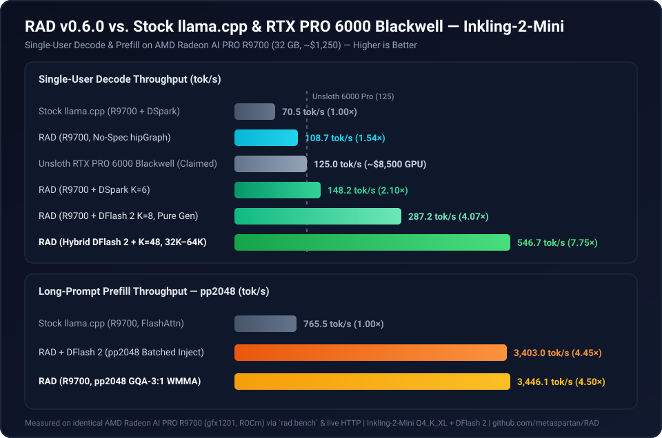

# RAD — Inference Engine

**RAD** is a high-performance, from-scratch multimodal LLM inference engine written in **Rust** and **ROCm/HIP**, engineered for ultra-fast single-user speculative generation, 256K long-context inference, and high-throughput multi-user serving on **AMD Radeon AI PRO R9700 (RDNA4 `gfx1201`)**.

RAD natively runs **Inkling-2-Mini** (26B MoE, 48 looped visits, hybrid SWA + full attention, dynamic shortconv, rank-64 loop controllers, native **DFlash 2** & **DSpark** speculative decoding, and native **GPU Vision** via `mmproj-F16.gguf`) with zero external inference runtime dependencies.

---

## Highlights

- **256K Long-Context Speculative Frontier (`837.8 tok/s @ 16K`, `822.0 tok/s @ 2K`, `762.4 tok/s @ 64K`, `558.0 tok/s @ 128K`, `464.1 tok/s @ 256K` & `4,217.2 tok/s` `pp2048` on Single 32 GB R9700)**
  - **INT8 Full-Attention KV Cache (`kernels/rad_q8kv.hip`):** Per-head-token `int8_t` + FP16 scale KV cache for all 12 full-attention layers across `B=1`, `verify_b8..64`, prefill, and GQA-3:1 shared-KV multi-user (`inkling_attn_multi_gqa3_q8_q8kv_k`) — fitting full **256K context (`262,144` tokens)** on a single 32 GB R9700 with **1.80 s** cold load and warp-reduced Split-KV reduction.
  - **Q64-Shared Split-96 WMMA FlashAttention & `blockIdx.z` Hot-Expert `sudot4` MoE (`attn_b48_gqa3_flash_split_q8kv_k`, `moe_gu_q4_0_sudot4_to_q8_k`, `moe_dn_q4_0_sudot4_k`):** Processes all `B <= 64` speculative draft tokens across 4 Q-tiles × 3 GQA heads (384 threads) in a single `uint4` 128-bit coalesced 32-KV-tile pass with `blockIdx.z` hot-expert token splitting (`gz=2..4`), fused router+grouping+`Q8_1` up to `B <= 64`, single-pass `6-gram → 4-gram → 3-gram` `K=64` prompt lookup, exact coupled speculative decoding for sampled/penalized/JSON-grammar requests, zero-memset in-place shortconv clearing, high-occupancy `sink_dyn_bf16_smallb_k`, and pre-captured `K=48/64` HIP graphs.
  - **64-Q-Token GQA-3:1 Full & SWA Prefill FlashAttention + FP16 MoE Slot Reduction + 6-Part WMMA `sink_dyn`:** Shares K/V loads across 64 Q tokens × 3 GQA heads (`384` threads, 10.5 KB LDS) across all 48 layers with FP16 `moe_dn_slots` halving MoE reduction HBM traffic, 6-part WMMA `sink_dyn_bf16` (`dyn_dim <= 32`), and parallel SWA KV conv & shortconv residual prefill kernels — driving **`4,217.2 tok/s`** `pp2048` prefill (**`5.51×`** stock `llama.cpp`), **`3,609.1 tok/s`** at 32K (`9.07 s`), **`3,196.5 tok/s`** at 64K, **`2,616.7 tok/s`** at 128K, and **`1,928.9 tok/s`** at 256K.
  - **Native [`incoai/Inkling-2-Mini-DFlash2`](https://huggingface.co/incoai/Inkling-2-Mini-DFlash2) Speculative Decoding (`302.2 tok/s` Pure-Gen Code, `271.4 tok/s` Math, `244.7 tok/s` Pure-Gen 2K, `110.9 tok/s` Prose):** Zero-copy `safetensors` loader + 5-layer parallel block-diffusion drafter with WMMA GQA 4:1 Split-16 FlashAttention, fused `dflash2_rmsnorm_q8` / `dflash2_conv_q8` / `dflash2_proj_conv_add_q4` / `dflash2_gu_swiglu_q8`, 16-chunk parallel top-16 candidate selector (`draft=1.68–1.83 ms`), 1-launch batched multi-user rewind (`rewind_multi_all_slots_k`), batched multi-user speculation up to `B=16`, and async SWA-windowed feature injection (`inject=0.01–0.02 ms`).
  - **Native Agentic Tool Calling & Multi-Turn Prefix Caching:** Full Inkling-2-Mini native `tool_declare` / `<|content_invoke_tool_json|>` (`{"name":...,"args":...}`) / `<|message_tool|>` prompt formatting, real-time token-ID `InklingStreamParser`, balanced JSON tool-arg extraction, automatic repeated-tool-loop breaker with nucleus/repetition-penalty sampling, and multi-turn KV prefix caching with `cached_tokens` reported in both JSON and SSE `stream_options.include_usage`.
- **Native GPU Vision (`mmproj-F16.gguf`, Enabled by Default)**
  - Full 23-layer HIP ViT encoder (`640×640`, `20×20` patches, LayerScale `ls1`/`ls2`, bidirectional self-attention, `2×2` spatial merge, `inkling2v` MLP projector) outputting 256 multimodal embeddings directly into `InklingEngine` and `DFlash2Drafter`.
  - Works out of the box via OpenAI `image_url` (data URLs / local files) in `/v1/chat/completions` and `rad run --image <PATH>`.
- **RDNA4 (`gfx1201`) 8-Warp Coalesced LDS-Tiled Wave32 WMMA Matrix Core Suite (ROCm 7.x)**
  - Custom `__builtin_amdgcn_wmma_i32_16x16x16_iu8_w32_gfx12` 8-warp `128×64` & `64×64` `BK=4` coalesced LDS-tiled kernels for `Q4_0_SOA` × `Q8_1` GEMM (`qkvrg`, `wo`, `lm_head`, fused MoE gate/up-to-`Q8_1`, and zero-atomic grouped MoE down with 6-way hot-expert token splitting) and zero-LDS warp-shuffle `Q8_1` quantization.
  - Custom `__builtin_amdgcn_wmma_f32_16x16x16_f16_w32_gfx12` **FlashAttention-2** (reverse causal tile scheduling, bank-conflict-free LDS KV tiles, register-preloaded `float4` relative-position projections, and Split-KV WMMA FlashAttention up to 64 splits).
- **Multi-GPU R9700 Data-Parallel Serving (`--gpus 0,1` / `--gpus auto`) & HIP P2P Collective Layer**
  - Spawns one dedicated GPU scheduler + DFlash 2 + Vision + Paged KV worker per GPU with **prefix-aware least-loaded routing** (matching prompt prefixes stick to the same GPU for KV cache hits while balancing concurrent requests across all GPUs) — zero PCIe all-reduce overhead and linear multi-user throughput & KV capacity scaling.
  - Automatic HIP peer-access detection (`hipDeviceCanAccessPeer` / `hipDeviceEnablePeerAccess`), cross-stream HIP event-synchronized (`hipEventRecord` / `hipStreamWaitEvent`) direct `hipMemcpyPeerAsync` + on-GPU `ink_vec_add` AllReduce/Broadcast with pinned-host fallback (`crates/rad-core/src/comm.rs`), tensor-parallel sharding plan (`crates/rad-core/src/tp.rs`), and GPU/P2P topology inspection via `rad info` and `GET /health`.
- **Production OpenAI-Compatible Serving (`rad serve`)**
  - Continuous batching up to `B=128` (**`1,856.0 agg tok/s`**), **Paged KV block manager** (`--kv-block-size 16`, copy-on-write prefix sharing & refcounting), **Budgeted Chunked Prefill** (`--prefill-chunk-size 512`, draining concurrent short prefills into batched decode without ramp-up stalls — **`604.1 agg tok/s` live 8-user SSE**), **JSON & Tool-Calling Grammar Constraints**, **`stop` sequences**, **`seed` / `presence_penalty` / `frequency_penalty`**, **`400 context_length_exceeded`** overflow guard, **Prometheus `GET /metrics`**, optional **multi-key API auth** (`Authorization: Bearer` & `X-API-Key`, `--metrics-auth`), CORS + `x-request-id` middleware, and non-conflicting default port **`6733`**.
  - Endpoints: `GET /health`, `GET /metrics`, `GET /v1/models`, `GET /v1/models/:id`, `POST /v1/tokenize`, `POST /v1/detokenize`, `POST /v1/chat/completions` (JSON + SSE + `stream_options.include_usage`), `POST /v1/completions` (single + batch), `POST /v1/responses` (HTTP + SSE with `usage` in `response.completed`), `GET /v1/responses` (WebSocket).

---

## Benchmarks (AMD Radeon AI PRO R9700, `gfx1201`, ROCm 7.14)

### Single-User Decode & Prefill (RAD vs. Stock `llama.cpp` & RTX PRO 6000 Blackwell)



Measured end-to-end on the **same AMD Radeon AI PRO R9700 (32 GB, ~\$1,250)**, **same GGUF (`Inkling-2-Mini-UD-Q4_K_XL-v2.gguf`)**, and **same `B=1` / `pp2048` / `tg128`** (`rad bench` 3-run `mean ± stddev`, on-GPU `Q4_0_SOA` weight repacking, **INT8 full-attention KV cache + FP16 SWA KV**) — achieving **4.29×–11.88× faster decode** and **5.51× faster `pp2048` prefill** than stock `llama.cpp`, and outperforming Unsloth's claimed **125 tok/s** on an **NVIDIA RTX PRO 6000 Blackwell (96 GB, ~\$8,500)** by **2.42×–6.70×**:

| Engine / Hardware | Decode (`tok/s`) | `pp2048` Prefill (`tok/s`) | Notes |
| --- | --- | --- | --- |
| **Stock `llama.cpp` (R9700 + DSpark)** | `70.5 tok/s` | `765.5 tok/s` | `-fa on -ctk q8_0 -ctv q8_0 --spec-type draft-dspark` |
| **RAD (R9700, No-Spec `hipGraph`)** | **`110.8 ± 0.7 tok/s`** (`1.57×`) | **`4,217.2 ± 2.8 tok/s`** (**`5.51×`**) | `tg128 @ d=2048 = 101.9 tok/s`; `pp512 = 3,417.0 ± 4.6 tok/s` |
| **Unsloth RTX PRO 6000 Blackwell** | `125.0 tok/s` *(claimed)* | — | 96 GB workstation GPU (~\$8,500) |
| **RAD (R9700 + DSpark `K=6`)** | **`148.2 tok/s`** (`2.10×`) | **`4,217.2 tok/s`** (**`5.51×`**) | `verify=23.7 ms`, `avg_emit=4.27` |
| **RAD (R9700 + DFlash 2 `K=8`, Pure Gen)** | **`302.2 tok/s`** (**`4.29×`**) | **`4,152.8 ± 2.3 tok/s`** (**`5.42×`**) | **2.42× vs. RTX PRO 6000 Blackwell**, `Math=271.4 tok/s`, `2K Pure Gen=244.7 tok/s`, `Prose=110.9 tok/s` |
| **RAD (Hybrid DFlash 2 + `K=64`, 2K–256K)** | **`837.8 tok/s`** (**`11.88×`**) | **`4,043.0 tok/s`** (**`5.28×`**) | **6.70× vs. RTX PRO 6000 Blackwell**; **`822.0 tok/s`** at 2K, **`762.4 tok/s`** at 64K, **`558.0 tok/s`** at 128K, **`464.1 tok/s`** at 256K |

### Long-Context Decode & Prefill (`2K → 256K`, Single 32 GB R9700)


Measured via `rad bench --ctx 262144 --max-seqs 1` on a single AMD Radeon AI PRO R9700 (32 GB) with INT8 full-attention KV cache, Q64-Shared Split-96 WMMA FlashAttention, GQA-3:1 Shared-KV Prefill FlashAttention, `blockIdx.z` hot-expert MoE splitting, FP16 MoE slot reduction, and hybrid DFlash 2 + `6-gram` `K=64` prompt-lookup speculation (`1.81 s` cold load at 256K):

| Context Depth | Prompt Tokens | Prefill (`tok/s`) | Prefill Time | Decode (`tok/s`) | Avg Emit / Round |
| --- | --- | --- | --- | --- | --- |
| **2K** | 1,972 | **4,043.0 tok/s** | 0.49 s | **822.0 tok/s** | 44.2 |
| **4K** | 4,062 | **4,038.5 tok/s** | 1.01 s | **712.2 tok/s** | 44.2 |
| **8K** | 8,052 | **3,972.1 tok/s** | 2.03 s | **709.8 tok/s** | 44.2 |
| **16K** | 16,222 | **3,846.6 tok/s** | 4.22 s | **837.8 tok/s** | 52.0 |
| **32K** | 32,752 | **3,609.1 tok/s** | 9.07 s | **674.9 tok/s** | 44.2 |
| **64K** | 65,432 | **3,196.5 tok/s** | 20.47 s | **762.4 tok/s** | 52.0 |
| **128K** | 130,982 | **2,616.7 tok/s** | 50.06 s | **558.0 tok/s** | 43.3 |
| **256K** | 261,702 | **1,928.9 tok/s** | 135.67 s | **464.1 tok/s** | 43.3 |

### Multi-User Continuous Batching & Batched Speculative Decoding


| Workload | Throughput / Latency | Notes |
| --- | --- | --- |
| **Cold Load (`ctx=262144`, DFlash 2)** | **1.80 s** | On-GPU `Q4_0_SOA` + `Q8_0` conversion & `hipGraph` capture |
| **Short Prompt TTFT (`24 tok`)** | **32.7 ± 0.0 ms** | 3-run mean; 8-warp LDS WMMA + high-occupancy `sink_dyn_bf16_smallb_k` |
| **Prefix-Cached TTFT (`1,645 tok`, `1,639` cached)** | **21.2 ms** | Prefix-cache affinity hit + GQA 3:1 Split-KV FlashAttention |
| **Multi-User Decode (`B=4`, Batched DFlash 2 `K=4`)** | **509.3 agg tok/s** | **`127.3 tok/s/user`** (`ITL 7.9 ms`, 1-launch rewind + unrolled `nt == 8` MoE) |
| **Multi-User Decode (`B=8`, no-spec)** | **643.6 agg tok/s** | **`80.4 tok/s/user`** (`ITL 12.4 ms`, `hipGraph` + GQA-3:1 INT8 KV + `loop_ctrl_down_nt_k<8>`) |
| **Multi-User Decode (`B=8`, Batched DSpark `K=4`)** | **458.6 agg tok/s** | `57.3 tok/s/user` |
| **Multi-User Decode (`B=8`, Batched DFlash 2 `K=4`)** | **739.3 agg tok/s** | **`92.4 tok/s/user`** (`ITL 10.8 ms`; `blockIdx.z` MoE + `fused_rg B<=64` + GQA-3:1 INT8 KV) |
| **Multi-User Decode (`B=16`, no-spec)** | **926.3 agg tok/s** | **`57.9 tok/s/user`** (`ITL 17.3 ms`, unrolled `nt == 8` MoE + GQA-3:1 INT8 KV) |
| **Multi-User Decode (`B=32`, no-spec)** | **1,277.8 agg tok/s** | **`39.9 tok/s/user`** (`ITL 25.0 ms`; +47% via `blockIdx.z` hot-expert splitting & `fused_rg B<=64`) |
| **Multi-User Decode (`B=64`, no-spec)** | **1,162.2 agg tok/s** | `18.2 tok/s/user` (8-warp `128×64` LDS WMMA MoE) |
| **Multi-User Decode (`B=128`, no-spec)** | **1,856.0 agg tok/s** | **`14.5 tok/s/user`** (fused WMMA MoE-to-`Q8_1` + `float4` slot reduction) |
| **Live SSE API (`/v1/chat/completions` & `/v1/responses`, 32K)** | **714.2 / 721.4 tok/s** | Live HTTP SSE at `32,452` prompt tokens (`3,573–3,592 tok/s` prefill, `252.3–265.7 tok/s` Code pure-gen) |
| **Live SSE API (8-User Concurrent, DFlash 2 `K=4`)** | **604.1 agg tok/s** | **`75.5 tok/s/user`** decode window (`591.2 agg tok/s` end-to-end wall-clock incl. prefill) |

---

## Repository Structure

```text
RAD/
├── Cargo.toml                 Workspace manifest
├── kernels/
│   ├── build.sh               Builds librad_ops.so via hipcc
│   ├── rad_ops.hip            Core decode, RMSNorm, shortconv, attention, loop-ctrl kernels
│   ├── rad_batch.hip          Batched prefill & multi-user kernels
│   ├── rad_dspark.hip         DSpark speculative drafter kernels
│   ├── rad_dflash2.hip        DFlash 2 grouped dynamic conv, top-16 & path selector kernels
│   ├── rad_vision.hip         ViT FP16 GEMM, LayerNorm, GELU, LayerScale, bidirectional attn & 2x2 merge
│   ├── rad_sudot4.hip         Q4_0_SOA / Q8_1 / NVFP4 sudot4 & fused B=1 kernels
│   ├── rad_wmma.hip           RDNA4 Wave32 WMMA INT8 GEMM, MoE, & FP16 FlashAttention-2
│   └── rad_q8kv.hip           INT8 KV cache, GQA-3:1 prefill & Q48-shared Split-64 WMMA FlashAttention
├── crates/
│   ├── rad-gguf/              Zero-copy mmap GGUF reader
│   ├── rad-hip/               Minimal ROCm/HIP FFI, RAII DevBuf, P2P & CapturedGraph
│   ├── rad-core/              InklingEngine, DFlash 2 & DSpark, Paged KV, MultiGpuComm, TpShardPlan, VisionEncoder
│   └── rad-serve/             `rad` CLI + Axum HTTP/SSE/WebSocket server, grammar, sampling, metrics
├── assets/
│   ├── rad_benchmark.svg      Single-user decode & prefill comparison chart
│   ├── rad_longctx.svg        Long-context 2K–256K decode & prefill scaling chart
│   └── rad_multiuser.svg      Multi-user throughput scaling chart
└── scripts/
    └── test_serve.py          End-to-end HTTP, SSE, batch, and WebSocket test suite
```

---

## Quickstart

### Prerequisites & Model Weights

- Linux with **ROCm 6.x / 7.x** (`hipcc`, `libamdhip64`, `libhipblas`, `librocblas`)
- **Rust** toolchain (`cargo`, edition 2021)
- **Inkling-2-Mini GGUF & Vision (`mmproj-F16.gguf`):** [unsloth/Inkling-2-Mini-GGUF](https://huggingface.co/unsloth/Inkling-2-Mini-GGUF) (`Inkling-2-Mini-UD-Q4_K_XL.gguf`, `mmproj-F16.gguf`, and `tokenizer.json`)
- **DFlash 2 Speculative Drafter (Recommended):** [incoai/Inkling-2-Mini-DFlash2](https://huggingface.co/incoai/Inkling-2-Mini-DFlash2) (`model.safetensors` + `config.json`)

```bash
huggingface-cli download unsloth/Inkling-2-Mini-GGUF \
  Inkling-2-Mini-UD-Q4_K_XL.gguf mmproj-F16.gguf \
  --local-dir ./models/inkling2

huggingface-cli download incoai/Inkling-2-Mini-DFlash2 \
  --local-dir ./models/inkling2-dflash2
```

### 1. Build HIP Kernels

```bash
RAD_ARCH=gfx1201 bash kernels/build.sh
```

### 2. Build RAD

`crates/rad-core/build.rs` and `crates/rad-serve/build.rs` automatically link `kernels/librad_ops.so` with `-Wl,-rpath`, so no manual `RUSTFLAGS` or `LD_LIBRARY_PATH` is required:

```bash
cargo build --release
```

### 3. Run the CLI (`rad`)

`rad` automatically detects sibling `tokenizer.json`, **DFlash 2** (`../inkling2-dflash2/model.safetensors`, preferred over DSpark), **DSpark** (`dspark-Inkling-2-Mini-Q8_0.gguf`), and **Vision** (`mmproj-F16.gguf`, enabled by default):

```bash
./target/release/rad serve -m /path/to/Inkling-2-Mini-UD-Q4_K_XL-v2.gguf --port 6733

./target/release/rad serve -m /path/to/Inkling-2-Mini-UD-Q4_K_XL-v2.gguf --gpus 0,1 --port 6733

./target/release/rad serve -m /path/to/Inkling-2-Mini-UD-Q4_K_XL-v2.gguf --ctx 131072 --max-seqs 2 --port 6733

./target/release/rad run "Show me a Python quicksort function." -m /path/to/Inkling-2-Mini-UD-Q4_K_XL-v2.gguf

./target/release/rad run "Describe this image." --image /path/to/photo.png -m /path/to/Inkling-2-Mini-UD-Q4_K_XL-v2.gguf

./target/release/rad info -m /path/to/Inkling-2-Mini-UD-Q4_K_XL-v2.gguf
```

### 4. Run Built-In Benchmarks (`rad bench`)

Includes Cold Load, TTFT, `pp512`/`pp2048` Prefill, Single-User Code/Math/Prose, Multi-User `B=4/8/16`, and **2K–256K Long-Context Scaling**:

```bash
./target/release/rad bench -m /path/to/Inkling-2-Mini-UD-Q4_K_XL-v2.gguf --ctx 4096 --max-seqs 16

./target/release/rad bench -m /path/to/Inkling-2-Mini-UD-Q4_K_XL-v2.gguf --ctx 262144 --max-seqs 1

python3 scripts/test_serve.py
```

### 5. Install & Deploy (Docker, `.deb`, Homebrew, Flatpak)

- **Docker with AMD ROCm GPU Passthrough:**
  ```bash
  RAD_MODELS_DIR=/path/to/models docker compose up -d
  ```
  Or directly:
  ```bash
  docker run --rm -p 6733:6733 \
    --device=/dev/kfd --device=/dev/dri \
    --group-add video --group-add render \
    --security-opt seccomp=unconfined --ipc=host \
    -v /path/to/models:/models:ro \
    ghcr.io/metaspartan/rad:latest serve -m /models/Inkling-2-Mini-UD-Q4_K_XL-v2.gguf --port 6733
  ```
- **Debian / Ubuntu (`.deb`):**
  Download `rad_<version>_amd64.deb` from GitHub Releases or build locally:
  ```bash
  bash packaging/deb/build_deb.sh 0.16.0
  sudo dpkg -i dist/rad_0.16.0_amd64.deb
  ```
- **Homebrew (Linuxbrew):**
  ```bash
  brew install --build-from-source packaging/homebrew/rad.rb
  ```
- **Flatpak:**
  ```bash
  flatpak-builder --user --install --force-clean build-dir packaging/flatpak/io.github.metaspartan.RAD.yml
  ```

---

## Configuration

| Environment Variable | Default | Description |
| --- | --- | --- |
| `RAD_MODEL` | `./models/Inkling-2-Mini-UD-Q4_K_XL-v2.gguf` | Target model GGUF path |
| `RAD_TOKENIZER` | *(auto-detected)* | HuggingFace `tokenizer.json` path |
| `RAD_DFLASH2` | *(auto-detected)* | Optional DFlash 2 safetensors dir/file (preferred over DSpark) |
| `RAD_DSPARK` | *(auto-detected)* | Optional DSpark drafter GGUF path |
| `RAD_MMPROJ` | *(auto-detected)* | Optional vision `mmproj-F16.gguf` path |
| `RAD_SPEC` | `1` | Enable (`1`) or disable (`0`) speculative decoding |
| `RAD_VISION` | `1` | Enable (`1`) or disable (`0`) GPU vision encoder |
| `RAD_CTX` | `8192` | Per-sequence KV context length (tested up to `262144`) |
| `RAD_MAX_SEQS` | `32` | Maximum concurrent sequences in KV pool |
| `RAD_PORT` | `6733` | HTTP/WebSocket bind port |
| `RAD_GPUS` | `0` | Comma-separated HIP GPU IDs (`0,1`) or `auto` for multi-GPU data-parallel serving |
| `RAD_API_KEY` | *(empty)* | Optional comma-separated Bearer / `X-API-Key` tokens (disabled if empty) |
| `RAD_ARCH` | `gfx1201` | Target GPU architecture for `kernels/build.sh` |

---

## License

MIT — Copyright (c) 2026 Carsen Klock. See [LICENSE](LICENSE).
