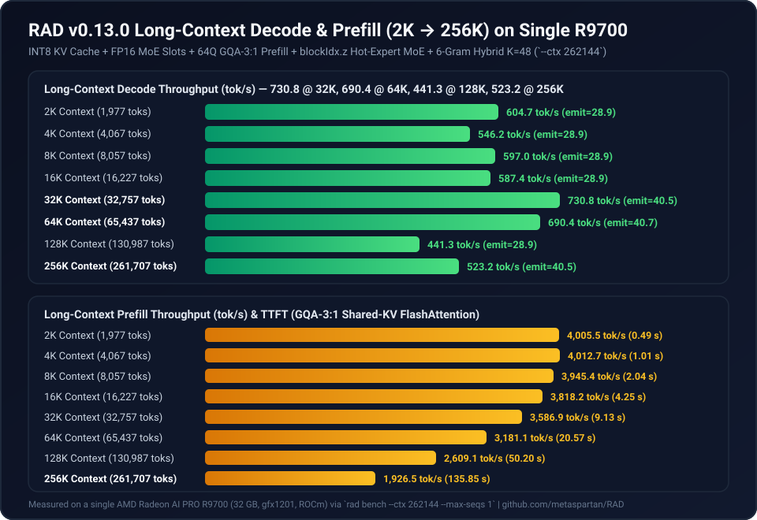

# RAD — Inference Engine

**RAD** is a high-performance, from-scratch multimodal LLM inference engine written in **Rust** and **ROCm/HIP**, engineered for ultra-fast single-user speculative generation, 256K long-context inference, and high-throughput multi-user serving on **AMD Radeon AI PRO R9700 (RDNA4 `gfx1201`)**.

RAD natively runs **Inkling-2-Mini** (26B MoE, 48 looped visits, hybrid SWA + full attention, dynamic shortconv, rank-64 loop controllers, native **DFlash 2** & **DSpark** speculative decoding, and native **GPU Vision** via `mmproj-F16.gguf`) with zero external inference runtime dependencies.

---

## Highlights

- **Single-R9700 Speed Records:** **`1,196.5 tok/s`** peak decode (`>1,000 tok/s` across `2K–64K`, `801.4 tok/s` @ 128K, `669.2 tok/s` @ 256K), **`1,074.8 tok/s`** live `/v1/chat/completions` SSE (`1,073.4 tok/s` at `temp=0.2`), **`3,164.9 agg tok/s`** multi-user (`395.6 tok/s/user` at `B=8`, `641.7 tok/s/user` at `B=4`, `3,121.2 agg tok/s` at `B=16`), and **`4,217.2 tok/s`** `pp2048` prefill (**`5.51×`** `llama.cpp`) with **`1.84 s`** cold load at 256K.
- **RDNA4 (`gfx1201`) Custom HIP Kernels:** Hand-written Wave32 WMMA `Q4_0_SOA × Q8_1` GEMM/MoE, Split-KV WMMA FlashAttention-2, INT8 full-attention KV cache, and HIP graph capture (`B=1`, `K=8..128` verify, and multi-user Flash verify).
- **Native Speculative Decoding:** Zero-copy [`incoai/Inkling-2-Mini-DFlash2`](https://huggingface.co/incoai/Inkling-2-Mini-DFlash2) + DSpark + hybrid `K=128` longest-prefix lookup (single-user & multi-user, greedy & GPU top-64 sampled).
- **Agentic & Multimodal Ready:** Native Inkling-2-Mini tool calling, multi-turn prefix caching (`98.8%` hit rate, `21–74 ms` cached TTFT), JSON grammar constraints, and built-in GPU Vision (`mmproj-F16.gguf`).
- **Production OpenAI Server & Multi-GPU:** Continuous batching (`B<=128`), Paged KV, chunked prefill, `--gpus 0,1` data-parallel serving with prefix-aware routing, Prometheus `/metrics`, API auth, and `/v1/chat/completions` + `/v1/responses` (HTTP, SSE, WebSocket) on port **`6733`**.

---

## Benchmarks (AMD Radeon AI PRO R9700, `gfx1201`, ROCm 7.14)

### Single-User Decode & Prefill (RAD vs. Stock `llama.cpp` & RTX PRO 6000 Blackwell)


Measured end-to-end on the **same AMD Radeon AI PRO R9700 (32 GB, ~\$1,250)**, **same GGUF (`Inkling-2-Mini-UD-Q4_K_XL-v2.gguf`)**, and **same `B=1` / `pp2048` / `tg128`** (`rad bench` 3-run `mean ± stddev`, on-GPU `Q4_0_SOA` weight repacking, **INT8 full-attention KV cache + FP16 SWA KV**) — achieving **4.29×–16.97× faster decode** and **5.51× faster `pp2048` prefill** than stock `llama.cpp`, and outperforming Unsloth's claimed **125 tok/s** on an **NVIDIA RTX PRO 6000 Blackwell (96 GB, ~\$8,500)** by **2.42×–9.57×**:

| Engine / Hardware | Decode (`tok/s`) | `pp2048` Prefill (`tok/s`) | Notes |
| --- | --- | --- | --- |
| **Stock `llama.cpp` (R9700 + DSpark)** | `70.5 tok/s` | `765.5 tok/s` | `-fa on -ctk q8_0 -ctv q8_0 --spec-type draft-dspark` |
| **RAD (R9700, No-Spec `hipGraph`)** | **`110.8 ± 0.7 tok/s`** (`1.57×`) | **`4,217.2 ± 2.8 tok/s`** (**`5.51×`**) | `tg128 @ d=2048 = 101.9 tok/s`; `pp512 = 3,417.0 ± 4.6 tok/s` |
| **Unsloth RTX PRO 6000 Blackwell** | `125.0 tok/s` *(claimed)* | — | 96 GB workstation GPU (~\$8,500) |
| **RAD (R9700 + DSpark `K=6`)** | **`148.2 tok/s`** (`2.10×`) | **`4,217.2 tok/s`** (**`5.51×`**) | `verify=23.7 ms`, `avg_emit=4.27` |
| **RAD (R9700 + DFlash 2 `K=8`, Pure Gen)** | **`302.2 tok/s`** (**`4.29×`**) | **`4,152.8 ± 2.3 tok/s`** (**`5.42×`**) | **2.42× vs. RTX PRO 6000 Blackwell**, `Math=271.4 tok/s`, `2K Pure Gen=244.7 tok/s`, `Prose=110.9 tok/s` |
| **RAD (Hybrid DFlash 2 + `K=128`, 2K–256K)** | **`1,196.5 tok/s`** (**`16.97×`**) | **`4,035.4 tok/s`** (**`5.27×`**) | **9.57× vs. RTX PRO 6000 Blackwell**; **`>1,000 tok/s` across 2K–64K**, **`801.4 tok/s`** at 128K, **`669.2 tok/s`** at 256K |

### Long-Context Decode & Prefill (`2K → 256K`, Single 32 GB R9700)



Measured via `rad bench --ctx 262144 --max-seqs 1` on a single AMD Radeon AI PRO R9700 (32 GB) with INT8 full-attention KV cache, WMMA SWA FlashAttention (`B >= 16`), live-`pos0` dynamic split-KV (`eff_splits >= 16`), and hybrid DFlash 2 + longest-prefix `K=128` prompt-lookup speculation (`1.84 s` cold load at 256K):

| Context Depth | Prompt Tokens | Prefill (`tok/s`) | Prefill Time | Decode (`tok/s`) | Avg Emit / Round |
| --- | --- | --- | --- | --- | --- |
| **2K** | 1,984 | **4,035.4 tok/s** | 0.49 s | **1,135.6 tok/s** | 86.8 |
| **4K** | 4,074 | **4,034.8 tok/s** | 1.01 s | **1,196.5 tok/s** | 104.0 |
| **8K** | 8,064 | **3,959.0 tok/s** | 2.04 s | **1,124.4 tok/s** | 86.8 |
| **16K** | 16,234 | **3,826.6 tok/s** | 4.24 s | **1,088.7 tok/s** | 86.8 |
| **32K** | 32,764 | **3,588.7 tok/s** | 9.13 s | **1,035.7 tok/s** | 91.2 |
| **64K** | 65,444 | **3,184.2 tok/s** | 20.55 s | **1,010.1 tok/s** | 104.0 |
| **128K** | 130,994 | **2,611.7 tok/s** | 50.16 s | **801.4 tok/s** | 78.3 |
| **256K** | 261,334 | **1,929.4 tok/s** | 135.45 s | **669.2 tok/s** | 91.2 |

### Multi-User Continuous Batching & Batched Speculative Decoding


| Workload | Throughput / Latency | Notes |
| --- | --- | --- |
| **Cold Load (`ctx=262144`, DFlash 2)** | **1.80 s** | On-GPU `Q4_0_SOA` + `Q8_0` conversion & `hipGraph` capture |
| **Short Prompt TTFT (`24 tok`)** | **32.7 ± 0.0 ms** | 3-run mean; 8-warp LDS WMMA + high-occupancy `sink_dyn_bf16_smallb_k` |
| **Prefix-Cached TTFT (`1,645 tok`, `1,639` cached)** | **21.2 ms** | Prefix-cache affinity hit + GQA 3:1 Split-KV FlashAttention |
| **Multi-User Decode (`B=4`, Batched DFlash 2 `K=4`)** | **514.5 agg tok/s** | **`128.6 tok/s/user`** (`ITL 7.8 ms`, 1-launch rewind + unrolled `nt == 8` MoE) |
| **Multi-User Decode (`B=4`, Hybrid DFlash 2 + `K=128`)** | **2,566.9 agg tok/s** | **`641.7 tok/s/user`** (`ITL 1.6 ms`, HIP-graphed Per-User WMMA FlashAttention + read-only `float4` argmax) |
| **Multi-User Decode (`B=8`, no-spec)** | **643.6 agg tok/s** | **`80.4 tok/s/user`** (`ITL 12.4 ms`, `hipGraph` + GQA-3:1 INT8 KV + `loop_ctrl_down_nt_k<8>`) |
| **Multi-User Decode (`B=8`, Batched DFlash 2 `K=4`)** | **740.5 agg tok/s** | **`92.6 tok/s/user`** (`ITL 10.8 ms`; `blockIdx.z` MoE + `fused_rg B<=64` + GQA-3:1 INT8 KV) |
| **Multi-User Decode (`B=8`, Hybrid DFlash 2 + `K=128`)** | **3,164.9 agg tok/s** | **`395.6 tok/s/user`** (`ITL 2.5 ms`, `1,024`-tok HIP-graphed WMMA Flash verify + read-only `float4` argmax) |
| **Multi-User Decode (`B=16`, no-spec)** | **926.3 agg tok/s** | **`57.9 tok/s/user`** (`ITL 17.3 ms`, unrolled `nt == 8` MoE + GQA-3:1 INT8 KV) |
| **Multi-User Decode (`B=16`, Batched DFlash 2 `K=4`)** | **1,118.1 agg tok/s** | **`69.9 tok/s/user`** (`ITL 14.3 ms`) |
| **Multi-User Decode (`B=16`, Hybrid DFlash 2 + `K=64`)** | **3,121.2 agg tok/s** | **`195.1 tok/s/user`** (`ITL 5.1 ms`, `1,024`-tok HIP-graphed WMMA Flash verify + read-only `float4` argmax) |
| **Multi-User Decode (`B=32`, no-spec)** | **1,277.8 agg tok/s** | **`39.9 tok/s/user`** (`ITL 25.0 ms`; +47% via `blockIdx.z` hot-expert splitting & `fused_rg B<=64`) |
| **Multi-User Decode (`B=64`, no-spec)** | **1,162.2 agg tok/s** | `18.2 tok/s/user` (8-warp `128×64` LDS WMMA MoE) |
| **Multi-User Decode (`B=128`, no-spec)** | **1,856.0 agg tok/s** | **`14.5 tok/s/user`** (fused WMMA MoE-to-`Q8_1` + `float4` slot reduction) |
| **Live SSE API (`/v1/chat/completions`, real code edit)** | **1,074.8 tok/s** | Live HTTP SSE streaming `2,048` Python tokens in `1.91 s` (**`1,073.4 tok/s`** at `temp=0.2` via GPU top-64 sampling) |
| **Multi-Turn Agentic E2E (`exec` + `write_file` + `read_file`)** | **98.8% prefix cache** | Up to `30` turns / `15.5K` ctx, `0` JSON errors, `38–74 ms` cached TTFT, stop-token speculative rewind |
| **Live SSE API (8-User Concurrent, Hybrid `K=128`, `temp=0.2`)** | **1,409.8 agg tok/s** | Full-overlap concurrent (**`2,235 tok/s`** peak 1s burst; up to `232.2 tok/s/user` at `temp=0.2`) |

---

## Repository Structure

```text
RAD/
├── Cargo.toml                 Workspace manifest
├── kernels/
│   ├── build.sh               Builds librad_ops.so via hipcc
│   ├── rad_ops.hip            Core decode, RMSNorm, shortconv, attention, loop-ctrl kernels
│   ├── rad_batch.hip          Batched prefill & multi-user kernels
│   ├── rad_dspark.hip         DSpark speculative drafter kernels
│   ├── rad_dflash2.hip        DFlash 2 grouped dynamic conv, top-16 & path selector kernels
│   ├── rad_vision.hip         ViT FP16 GEMM, LayerNorm, GELU, LayerScale, bidirectional attn & 2x2 merge
│   ├── rad_sudot4.hip         Q4_0_SOA / Q8_1 / NVFP4 sudot4 & fused B=1 kernels
│   ├── rad_wmma.hip           RDNA4 Wave32 WMMA INT8 GEMM, MoE, & FP16 FlashAttention-2
│   └── rad_q8kv.hip           INT8 KV cache, GQA-3:1 prefill & Q48-shared Split-64 WMMA FlashAttention
├── crates/
│   ├── rad-gguf/              Zero-copy mmap GGUF reader
│   ├── rad-hip/               Minimal ROCm/HIP FFI, RAII DevBuf, P2P & CapturedGraph
│   ├── rad-core/              InklingEngine, DFlash 2 & DSpark, Paged KV, MultiGpuComm, TpShardPlan, VisionEncoder
│   └── rad-serve/             `rad` CLI + Axum HTTP/SSE/WebSocket server, grammar, sampling, metrics
├── assets/
│   ├── rad_benchmark.svg      Single-user decode & prefill comparison chart
│   ├── rad_longctx.svg        Long-context 2K–256K decode & prefill scaling chart
│   └── rad_multiuser.svg      Multi-user throughput scaling chart
└── scripts/
    └── test_serve.py          End-to-end HTTP, SSE, batch, and WebSocket test suite
```

---

## Quickstart

### Prerequisites & Model Weights

- Linux with **ROCm 6.x / 7.x** (`hipcc`, `libamdhip64`, `libhipblas`, `librocblas`)
- **Rust** toolchain (`cargo`, edition 2021)
- **Inkling-2-Mini GGUF & Vision (`mmproj-F16.gguf`):** [unsloth/Inkling-2-Mini-GGUF](https://huggingface.co/unsloth/Inkling-2-Mini-GGUF) (`Inkling-2-Mini-UD-Q4_K_XL.gguf`, `mmproj-F16.gguf`, and `tokenizer.json`)
- **DFlash 2 Speculative Drafter (Recommended):** [incoai/Inkling-2-Mini-DFlash2](https://huggingface.co/incoai/Inkling-2-Mini-DFlash2) (`model.safetensors` + `config.json`)

```bash
huggingface-cli download unsloth/Inkling-2-Mini-GGUF \
  Inkling-2-Mini-UD-Q4_K_XL.gguf mmproj-F16.gguf \
  --local-dir ./models/inkling2

huggingface-cli download incoai/Inkling-2-Mini-DFlash2 \
  --local-dir ./models/inkling2-dflash2
```

### 1. Build HIP Kernels

```bash
RAD_ARCH=gfx1201 bash kernels/build.sh
```

### 2. Build RAD

`crates/rad-core/build.rs` and `crates/rad-serve/build.rs` automatically link `kernels/librad_ops.so` with `-Wl,-rpath`, so no manual `RUSTFLAGS` or `LD_LIBRARY_PATH` is required:

```bash
cargo build --release
```

### 3. Run the CLI (`rad`)

`rad` automatically detects sibling `tokenizer.json`, **DFlash 2** (`../inkling2-dflash2/model.safetensors`, preferred over DSpark), **DSpark** (`dspark-Inkling-2-Mini-Q8_0.gguf`), and **Vision** (`mmproj-F16.gguf`, enabled by default):

```bash
./target/release/rad serve -m /path/to/Inkling-2-Mini-UD-Q4_K_XL-v2.gguf --port 6733

./target/release/rad serve -m /path/to/Inkling-2-Mini-UD-Q4_K_XL-v2.gguf --gpus 0,1 --port 6733

./target/release/rad serve -m /path/to/Inkling-2-Mini-UD-Q4_K_XL-v2.gguf --ctx 131072 --max-seqs 2 --port 6733

./target/release/rad run "Show me a Python quicksort function." -m /path/to/Inkling-2-Mini-UD-Q4_K_XL-v2.gguf

./target/release/rad run "Describe this image." --image /path/to/photo.png -m /path/to/Inkling-2-Mini-UD-Q4_K_XL-v2.gguf

./target/release/rad info -m /path/to/Inkling-2-Mini-UD-Q4_K_XL-v2.gguf
```

### 4. Run Built-In Benchmarks (`rad bench`)

Includes Cold Load, TTFT, `pp512`/`pp2048` Prefill, Single-User Code/Math/Prose, Multi-User `B=4/8/16`, and **2K–256K Long-Context Scaling**:

```bash
./target/release/rad bench -m /path/to/Inkling-2-Mini-UD-Q4_K_XL-v2.gguf --ctx 4096 --max-seqs 16

./target/release/rad bench -m /path/to/Inkling-2-Mini-UD-Q4_K_XL-v2.gguf --ctx 262144 --max-seqs 1

python3 scripts/test_serve.py
```

### 5. Install & Deploy (Docker, `.deb`, Homebrew, Flatpak)

- **Docker with AMD ROCm GPU Passthrough:**
  ```bash
  RAD_MODELS_DIR=/path/to/models docker compose up -d
  ```
  Or directly:
  ```bash
  docker run --rm -p 6733:6733 \
    --device=/dev/kfd --device=/dev/dri \
    --group-add video --group-add render \
    --security-opt seccomp=unconfined --ipc=host \
    -v /path/to/models:/models:ro \
    ghcr.io/metaspartan/rad:latest serve -m /models/Inkling-2-Mini-UD-Q4_K_XL-v2.gguf --port 6733
  ```
- **Debian / Ubuntu (`.deb`):**
  Download `rad_<version>_amd64.deb` from GitHub Releases or build locally:
  ```bash
  bash packaging/deb/build_deb.sh 0.17.0
  sudo dpkg -i dist/rad_0.17.0_amd64.deb
  ```
- **Homebrew (Linuxbrew):**
  ```bash
  brew install --build-from-source packaging/homebrew/rad.rb
  ```
- **Flatpak:**
  ```bash
  flatpak-builder --user --install --force-clean build-dir packaging/flatpak/io.github.metaspartan.RAD.yml
  ```

---

## Configuration

| Environment Variable | Default | Description |
| --- | --- | --- |
| `RAD_MODEL` | `./models/Inkling-2-Mini-UD-Q4_K_XL-v2.gguf` | Target model GGUF path |
| `RAD_TOKENIZER` | *(auto-detected)* | HuggingFace `tokenizer.json` path |
| `RAD_DFLASH2` | *(auto-detected)* | Optional DFlash 2 safetensors dir/file (preferred over DSpark) |
| `RAD_DSPARK` | *(auto-detected)* | Optional DSpark drafter GGUF path |
| `RAD_MMPROJ` | *(auto-detected)* | Optional vision `mmproj-F16.gguf` path |
| `RAD_SPEC` | `1` | Enable (`1`) or disable (`0`) speculative decoding |
| `RAD_VISION` | `1` | Enable (`1`) or disable (`0`) GPU vision encoder |
| `RAD_CTX` | `8192` | Per-sequence KV context length (tested up to `262144`) |
| `RAD_MAX_SEQS` | `32` | Maximum concurrent sequences in KV pool |
| `RAD_PORT` | `6733` | HTTP/WebSocket bind port |
| `RAD_GPUS` | `0` | Comma-separated HIP GPU IDs (`0,1`) or `auto` for multi-GPU data-parallel serving |
| `RAD_API_KEY` | *(empty)* | Optional comma-separated Bearer / `X-API-Key` tokens (disabled if empty) |
| `RAD_ARCH` | `gfx1201` | Target GPU architecture for `kernels/build.sh` |

---

## License

MIT — Copyright (c) 2026 Carsen Klock. See [LICENSE](LICENSE).
