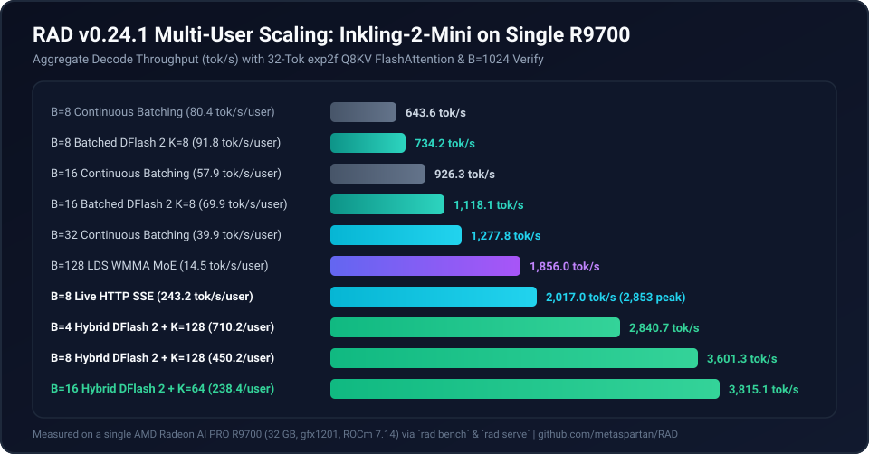

# RAD — Inference Engine

**RAD** is a high-performance, from-scratch multimodal LLM inference engine written in **Rust** and **ROCm/HIP**, engineered for ultra-fast single-user speculative generation and high-throughput multi-user serving.

The current focus of RAD is **Inkling-2-Mini** (26B MoE, 48 looped visits, hybrid SWA + full attention, dynamic shortconv, rank-64 loop controllers, native **DFlash 2** & **DSpark** speculative decoding, and native **GPU Vision** via `mmproj-F16.gguf`) on **AMD Radeon AI PRO R9700 (RDNA4 `gfx1201`)**, with a modular crate architecture built to expand to additional hardware targets and model families.

---

## Highlights

- **Long-Context Speculative Frontier (`403.9–474.2 tok/s` Live Decode & `2,884–3,198 tok/s` Prefill Across `2K–32K` Context)**
  - **INT8 Full-Attention KV Cache (`kernels/rad_q8kv.hip`):** Per-head-token `int8_t` + FP16 scale KV cache for all 12 full-attention layers across `B=1`, `verify_b8..48`, prefill, and multi-user — slashing `32K × 8-seq` VRAM by **`-4.23 GB`** (`28.15 GB -> 23.92 GB`) and cutting long-context KV bandwidth in half.
  - **Split-32 GQA 3:1 WMMA FlashAttention (`B <= 48`) + Hybrid DFlash 2 & Bucketed `K=48` Prompt-Lookup Speculation:** Generalizes WMMA GQA-3:1 Split-32 FlashAttention across `blockIdx.z` for `B <= 48` (triggering WMMA MoE at `B=48`), holding live decode at **`403.9 tok/s (2K)`**, **`474.2 tok/s (4K)`**, **`468.5 tok/s (8K)`**, **`455.8 tok/s (16K)`**, and **`432.6 tok/s (32K / 31,415 tokens)`** — only **`-8.8%`** drop from 4K to 32K!
  - **Native `incoai/Inkling-2-Mini-DFlash2` Speculative Decoding (`287.2 tok/s` Pure-Gen Code, `236.4 tok/s` Pure-Gen 2K, `227.4 tok/s` Math, `98.5 tok/s` Prose, `3,409.3 tok/s` `pp2048` Prefill):** Zero-copy `safetensors` loader + 5-layer parallel block-diffusion drafter with WMMA GQA 4:1 Split-16 FlashAttention, fused `dflash2_rmsnorm_q8` / `dflash2_conv_q8` / `dflash2_proj_conv_add_q4` / `dflash2_gu_swiglu_q8`, 16-chunk parallel top-16 candidate selector (`draft=1.70–1.84 ms` even at `2K+ ctx`), tiled LDS `qkvrg`/`wo`, hoisted nibble unpacks across all MoE `sudot4` paths, coalesced `float4`/`uint32_t` `B=1` INT8 KV attention, no-zero `moe_dn` + `shortconv_res_clear`, and SWA-windowed prefill feature injection (`verify=19.13–21.38 ms`, `inject=0.01–0.02 ms` async).
  - **Native Agentic Tool Calling (Streaming SSE, HTTP & WebSocket):** Full Inkling-2-Mini native `tool_declare` / `<|content_invoke_tool_json|>` / `<|message_tool|>` prompt formatting and real-time token-ID `InklingStreamParser` across `/v1/chat/completions` (`delta.tool_calls`, `delta.reasoning_content`, `finish_reason: "tool_calls"`) and `/v1/responses` (`function_call`, `function_call_output`, `response.output_item.*` events).
  - Full `hipGraph`-captured draft & verify loops for both single-user (`B=1` `tg128 = 108.7 tok/s`, `tg128 @ d=2048 = 99.1 tok/s`) and multi-user (`B=4` at **`485.0 agg tok/s` / `121.2 tok/s/user`**, `B=8` at **`676.2 agg tok/s` / `84.5 tok/s/user`**, `B=8` no-spec **`558.2 agg tok/s`**, `B=16` no-spec **`685.9 agg tok/s`**), plus fallback support for **DSpark** (`dspark-Inkling-2-Mini-Q8_0.gguf`).
- **Native GPU Vision (`mmproj-F16.gguf`, Enabled by Default)**
  - Full 23-layer HIP ViT encoder (`640×640`, `20×20` patches, LayerScale `ls1`/`ls2`, bidirectional self-attention, `2×2` spatial merge, `inkling2v` MLP projector) outputting 256 multimodal embeddings directly into `InklingEngine` and `DFlash2Drafter`.
  - Works out of the box via OpenAI `image_url` (data URLs / local files) in `/v1/chat/completions` and `rad run --image <PATH>`.
- **RDNA4 (`gfx1201`) 8-Warp Coalesced LDS-Tiled Wave32 WMMA Matrix Core Suite (ROCm 7.x)**
  - Custom `__builtin_amdgcn_wmma_i32_16x16x16_iu8_w32_gfx12` 8-warp `128×64` & `64×64` `BK=4` coalesced LDS-tiled kernels for `Q4_0_SOA` × `Q8_1` GEMM (`qkvrg`, `wo`, `lm_head`, fused MoE gate/up-to-`Q8_1` eliminating `3.6 GB` FP32 round-trips on `pp2048`, and zero-atomic grouped MoE down with 6-way hot-expert token splitting), zero-LDS warp-shuffle `Q8_1` quantization, compiled with `-ffast-math -munsafe-fp-atomics`.
  - Custom `__builtin_amdgcn_wmma_f32_16x16x16_f16_w32_gfx12` **FlashAttention-2** (reverse causal tile scheduling, bank-conflict-free LDS KV tile, register-preloaded `float4` relative-position projections, plus 4-warp Split-KV WMMA FlashAttention for `B=4..16`), fused multi-query `float4` state mixing (`mix_batch_f4_k`), register-cached `float4` RMSNorm, WMMA `sink_dyn_bf16`, single-pass `float4` & LDS WMMA loop controllers, and 64-CU `float4` router GEMM/GEMV.
- **On-GPU `Q4_0_SOA` Weight Repacking & `hipGraph` Execution**
  - Converts `Q8_0`, `NVFP4`, and `BF16` tensors directly on GPU at load time (**~1.16 s** cold load) into 16-byte-aligned structure-of-arrays blocks for coalesced `uint4` loads and `sudot4` / WMMA execution.
- **vLLM-Style Continuous Batching, Paged KV Cache, Chunked Prefill, Tool-Calling Grammar & Prometheus Metrics (`rad`)**
  - Dedicated GPU scheduler thread with **Paged KV block management** (`--kv-block-size 16`, copy-on-write prefix sharing & refcounting), **Chunked Prefill** (`--prefill-chunk-size 512`, interleaving long prefills with active decoders), **JSON & Tool-Calling Grammar Constraints** (`response_format: json_object/json_schema`, `tools` + `tool_choice` -> OpenAI `tool_calls`), **Prometheus `GET /metrics`** (TTFT/ITL histograms, speculative acceptance rate, KV block utilization), optional **multi-key API auth** (`Authorization: Bearer` & `X-API-Key`, `--metrics-auth`), and non-conflicting default port **`6733`**.
  - Continuous batched decode (`step_multi` with GQA 3:1 attention) scaling up to `B=128` concurrent sequences (**`1,856.0 agg tok/s`**).
  - `GET /health`, `GET /metrics`, `GET /v1/models`, `POST /v1/chat/completions` (text + vision + tools + JSON grammar, JSON + SSE), `POST /v1/completions` (single + batch), `POST /v1/responses` (HTTP + SSE), `GET /v1/responses` (WebSocket).

---

## Benchmarks (AMD Radeon AI PRO R9700, `gfx1201`, ROCm 7.14)

### Single-User Decode & Prefill (RAD vs. Stock `llama.cpp` & RTX PRO 6000 Blackwell)


Measured end-to-end on the **same AMD Radeon AI PRO R9700 (32 GB, ~\$1,250)**, **same GGUF (`Inkling-2-Mini-UD-Q4_K_XL-v2.gguf`)**, and **same `B=1` / `ctx=4096` / `pp2048` / `tg128`** (`llama-bench` / vLLM-parity 3-run `mean ± stddev` via `rad bench`; RAD repacks GGUF `NVFP4`/`Q8_0` linear weights on-GPU to `Q4_0_SOA` at load time with **INT8 full-attention KV cache + FP16 SWA KV**) — achieving **3.97×–6.73× faster decode** and **4.45× faster `pp2048` prefill** than stock `llama.cpp`, and outperforming Unsloth's claimed **125 tok/s** on an **NVIDIA RTX PRO 6000 Blackwell (96 GB, ~\$8,500)** by **2.24×–3.79×**:

| Engine / Hardware | Decode (`tok/s`) | `pp2048` Prefill (`tok/s`) | Notes |
| --- | --- | --- | --- |
| **Stock `llama.cpp` (R9700 + DSpark)** | `70.5 tok/s` | `765.5 tok/s` | `-fa on -ctk q8_0 -ctv q8_0 --spec-type draft-dspark` |
| **RAD (R9700, No-Spec `hipGraph`)** | **`108.7 ± 0.7 tok/s`** (`1.54×`) | **`3,409.3 ± 2.0 tok/s`** (**`4.45×`**) | `tg128 @ d=2048 = 99.1 tok/s`; `pp512 = 2,918.1 ± 7.2 tok/s` |
| **Unsloth RTX PRO 6000 Blackwell** | `125.0 tok/s` *(claimed)* | — | 96 GB workstation GPU (~\$8,500) |
| **RAD (R9700 + DSpark `K=6`)** | **`148.2 tok/s`** (`2.10×`) | **`3,409.3 tok/s`** (**`4.45×`**) | `verify=23.7 ms`, `avg_emit=4.27` |
| **RAD (R9700 + DFlash 2 `K=8`, Pure Gen)** | **`287.2 tok/s`** (**`4.07×`**) | **`3,368.0 ± 1.3 tok/s`** (**`4.40×`**) | **2.30× vs. RTX PRO 6000 Blackwell**, `draft=1.70–1.84 ms`, `verify=19.13–20.75 ms`, `Math=227.4 tok/s`, `2K Pure Gen=236.4 tok/s` |
| **RAD (Hybrid DFlash 2 + `K=48`, 4K–32K Edit)** | **`474.2 tok/s`** (**`6.73×`**) | **`3,197.5 tok/s`** (**`4.18×`**) | **3.79× vs. RTX PRO 6000 Blackwell**, live HTTP **`403.9–474.2 tok/s`** across `2K–16K` and **`432.6 tok/s`** at full `32K`! |

### Long-Context Decode & Prefill (`2K → 32K`, Live OpenAI HTTP on Single R9700)


Measured live via `/v1/chat/completions` on `rad serve --ctx 32768 --max-seqs 8` with INT8 full-attention KV cache (`-4.23 GB` VRAM), Split-32 GQA 3:1 WMMA FlashAttention (`B <= 48`), WMMA MoE at `B=48`, and hybrid DFlash 2 + bucketed 4-gram/3-gram prompt-lookup speculation:

| Context Depth | Prompt Tokens | Live Prefill (`tok/s`) | TTFT | Live Decode (`tok/s`) | Avg Emit / Round | ms / Round |
| --- | --- | --- | --- | --- | --- | --- |
| **2K** | 2,089 | **3,141.9 tok/s** | 664.9 ms | **403.9 tok/s** | 32.25 | 68.1 ms |
| **4K** | 4,135 | **3,197.5 tok/s** | 1,293.2 ms | **474.2 tok/s** | 34.71 | 66.3 ms |
| **8K** | 8,227 | **3,179.1 tok/s** | 2,587.8 ms | **468.5 tok/s** | 34.71 | 67.1 ms |
| **16K** | 16,411 | **3,080.5 tok/s** | 5,327.4 ms | **455.8 tok/s** | 34.71 | 68.9 ms |
| **32K** | 31,415 | **2,884.3 tok/s** | 10,891.9 ms | **432.6 tok/s** | 34.71 | 72.6 ms |

### Multi-User Continuous Batching & Batched Speculative Decoding



| Workload | Throughput / Latency | Notes |
| --- | --- | --- |
| **Cold Load (`max_seqs=16`, DFlash 2)** | **1.93 s** | On-GPU `Q4_0_SOA` + `Q8_0` conversion & `hipGraph` capture |
| **Short Prompt TTFT (`15 tok`)** | **34.8 ± 0.1 ms** | 3-run mean; 8-warp LDS WMMA + fused `float4` state mixing |
| **Prefix-Cached TTFT (`1,645 tok`, `1,639` cached)** | **21.2 ms** | Prefix-cache affinity hit + GQA 3:1 Split-KV FlashAttention |
| **Multi-User Decode (`B=4`, Batched DFlash 2 `K=4`)** | **485.0 agg tok/s** | **`121.2 tok/s/user`** (`ITL 8.2 ms`, zero-spill MoE + LDS WMMA) |
| **Multi-User Decode (`B=8`, no-spec)** | **558.2 agg tok/s** | **`69.8 tok/s/user`** (`ITL 14.3 ms`, `hipGraph` + fused `router+groups+Q8_1` + tiled LDS `qkvrg`) |
| **Multi-User Decode (`B=8`, Batched DSpark `K=4`)** | **458.6 agg tok/s** | `57.3 tok/s/user` |
| **Multi-User Decode (`B=8`, Batched DFlash 2 `K=4`)** | **676.2 agg tok/s** | **`84.5 tok/s/user`** (`ITL 11.8 ms`; 8 concurrent users each faster than single-user `llama.cpp`) |
| **Multi-User Decode (`B=16`, no-spec)** | **685.9 agg tok/s** | **`42.9 tok/s/user`** (`ITL 23.3 ms`) |
| **Multi-User Decode (`B=32`, no-spec)** | **867.2 agg tok/s** | `27.1 tok/s/user` (GQA 3:1 multi-user attention + `float4` RMSNorm) |
| **Multi-User Decode (`B=64`, no-spec)** | **1,162.2 agg tok/s** | `18.2 tok/s/user` (8-warp `128×64` LDS WMMA MoE) |
| **Multi-User Decode (`B=128`, no-spec)** | **1,856.0 agg tok/s** | **`14.5 tok/s/user`** (fused WMMA MoE-to-`Q8_1` + `float4` slot reduction) |

---

## Repository Structure

```text
RAD/
├── Cargo.toml                 Workspace manifest
├── kernels/
│   ├── build.sh               Builds librad_ops.so via hipcc
│   ├── rad_ops.hip            Core decode, RMSNorm, shortconv, attention, loop-ctrl kernels
│   ├── rad_batch.hip          Batched prefill & multi-user kernels
│   ├── rad_dspark.hip         DSpark speculative drafter kernels
│   ├── rad_dflash2.hip        DFlash 2 grouped dynamic conv, top-16 & path selector kernels
│   ├── rad_vision.hip         ViT FP16 GEMM, LayerNorm, GELU, LayerScale, bidirectional attn & 2x2 merge
│   ├── rad_sudot4.hip         Q4_0_SOA / Q8_1 / NVFP4 sudot4 & fused B=1 kernels
│   ├── rad_wmma.hip           RDNA4 Wave32 WMMA INT8 GEMM, MoE, & FP16 FlashAttention-2
│   └── rad_q8kv.hip           INT8 per-head-token full-attention KV cache & Split-32 WMMA kernels
├── crates/
│   ├── rad-gguf/              Zero-copy mmap GGUF reader
│   ├── rad-hip/               Minimal ROCm/HIP FFI, RAII DevBuf, and CapturedGraph
│   ├── rad-core/              Model engine, DFlash 2 & DSpark drafters, Paged KV, VisionEncoder
│   └── rad-serve/             `rad` CLI + Axum HTTP/SSE/WebSocket server, grammar, metrics
├── assets/
│   ├── rad_benchmark.svg      Single-user decode & prefill comparison chart
│   ├── rad_longctx.svg        Long-context 2K–32K decode & prefill scaling chart
│   └── rad_multiuser.svg      Multi-user throughput scaling chart
└── scripts/
    └── test_serve.py          End-to-end HTTP, SSE, batch, and WebSocket test suite
```

---

## Quickstart

### Prerequisites

- Linux with **ROCm 6.x / 7.x** (`hipcc`, `libamdhip64`, `libhipblas`, `librocblas`)
- **Rust** toolchain (`cargo`, edition 2021)
- GGUF model weights + `tokenizer.json` (plus optional `incoai/Inkling-2-Mini-DFlash2`, `dspark-Inkling-2-Mini-Q8_0.gguf`, and `mmproj-F16.gguf`)

### 1. Build HIP Kernels

```bash
RAD_ARCH=gfx1201 bash kernels/build.sh
```

### 2. Build RAD

`crates/rad-core/build.rs` and `crates/rad-serve/build.rs` automatically link `kernels/librad_ops.so` with `-Wl,-rpath`, so no manual `RUSTFLAGS` or `LD_LIBRARY_PATH` is required:

```bash
cargo build --release
```

### 3. Run the CLI (`rad`)

`rad` automatically detects sibling `tokenizer.json`, **DFlash 2** (`../inkling2-dflash2/model.safetensors`, preferred over DSpark), **DSpark** (`dspark-Inkling-2-Mini-Q8_0.gguf`), and **Vision** (`mmproj-F16.gguf`, enabled by default):

```bash
./target/release/rad serve -m /path/to/Inkling-2-Mini-UD-Q4_K_XL-v2.gguf --port 6733

./target/release/rad run "Show me a Python quicksort function." -m /path/to/Inkling-2-Mini-UD-Q4_K_XL-v2.gguf

./target/release/rad run "Describe this image." --image /path/to/photo.png -m /path/to/Inkling-2-Mini-UD-Q4_K_XL-v2.gguf

./target/release/rad info -m /path/to/Inkling-2-Mini-UD-Q4_K_XL-v2.gguf
```

### 4. Run Built-In Benchmarks (`rad bench`)

Includes Cold Load, TTFT, No-Spec & DFlash 2 Long Prefill, Single-User Code, Large-Context Code (2K ctx), Math, Prose, and Multi-User `B=4/8/16`:

```bash
./target/release/rad bench -m /path/to/Inkling-2-Mini-UD-Q4_K_XL-v2.gguf --ctx 4096 --max-seqs 16

python3 scripts/test_serve.py
```

### 5. Install & Deploy (Docker, `.deb`, Homebrew, Flatpak)

- **Docker with AMD ROCm GPU Passthrough:**
  ```bash
  RAD_MODELS_DIR=/path/to/models docker compose up -d
  ```
  Or directly:
  ```bash
  docker run --rm -p 8088:8088 \
    --device=/dev/kfd --device=/dev/dri \
    --group-add video --group-add render \
    --security-opt seccomp=unconfined --ipc=host \
    -v /path/to/models:/models:ro \
    ghcr.io/metaspartan/rad:latest serve -m /models/Inkling-2-Mini-UD-Q4_K_XL-v2.gguf --port 8088
  ```
- **Debian / Ubuntu (`.deb`):**
  Download `rad_<version>_amd64.deb` from GitHub Releases (built automatically by `.github/workflows/release.yml` on `v*` tags) or build locally:
  ```bash
  bash packaging/deb/build_deb.sh 0.1.0
  sudo dpkg -i dist/rad_0.1.0_amd64.deb
  ```
- **Homebrew (Linuxbrew):**
  ```bash
  brew install --build-from-source packaging/homebrew/rad.rb
  ```
- **Flatpak:**
  ```bash
  flatpak-builder --user --install --force-clean build-dir packaging/flatpak/io.github.metaspartan.RAD.yml
  ```

---

## Configuration

| Environment Variable | Default | Description |
| --- | --- | --- |
| `RAD_MODEL` | `./models/Inkling-2-Mini-UD-Q4_K_XL-v2.gguf` | Target model GGUF path |
| `RAD_TOKENIZER` | *(auto-detected)* | HuggingFace `tokenizer.json` path |
| `RAD_DFLASH2` | *(auto-detected)* | Optional DFlash 2 safetensors dir/file (preferred over DSpark) |
| `RAD_DSPARK` | *(auto-detected)* | Optional DSpark drafter GGUF path |
| `RAD_MMPROJ` | *(auto-detected)* | Optional vision `mmproj-F16.gguf` path |
| `RAD_SPEC` | `1` | Enable (`1`) or disable (`0`) speculative decoding |
| `RAD_VISION` | `1` | Enable (`1`) or disable (`0`) GPU vision encoder |
| `RAD_CTX` | `8192` | Per-sequence KV context length |
| `RAD_MAX_SEQS` | `32` | Maximum concurrent sequences in KV pool |
| `RAD_PORT` | `6733` | HTTP/WebSocket bind port |
| `RAD_API_KEY` | *(empty)* | Optional comma-separated Bearer / `X-API-Key` tokens (disabled if empty) |
| `RAD_ARCH` | `gfx1201` | Target GPU architecture for `kernels/build.sh` |

---

## Roadmap

- **Hardware backends:** CDNA (`gfx942` / MI300X), RDNA3 (`gfx1100`), NVIDIA CUDA, and Apple Metal backends behind a unified device trait.
- **Model families:** Standard GQA/MLA transformers, Qwen3-MoE, Llama, DeepSeek, and hybrid SSM/attention architectures.
- **Serving features (shipped in v0.2–v0.3):** Paged KV cache with prefix sharing, chunked prefill, JSON & tool-calling grammar constraints, Prometheus `/metrics`, optional multi-key API auth, INT8 full-attention KV cache, and hybrid DFlash 2 + `K=48` prompt-lookup speculation.

---

## License

MIT — Copyright (c) 2026 Carsen Klock. See [LICENSE](LICENSE).
